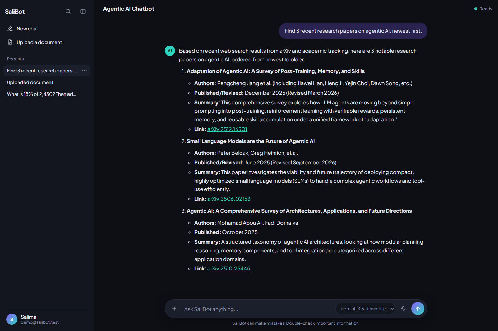
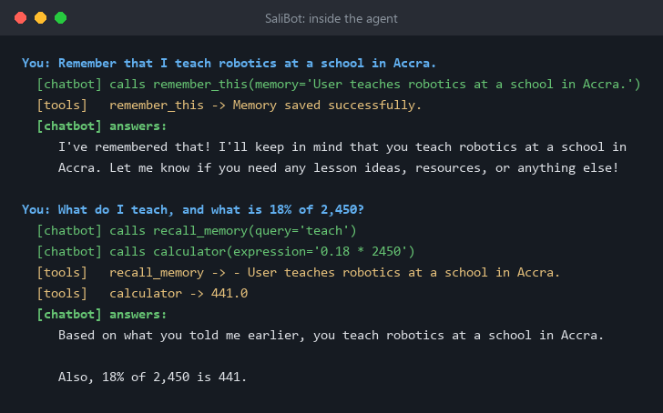
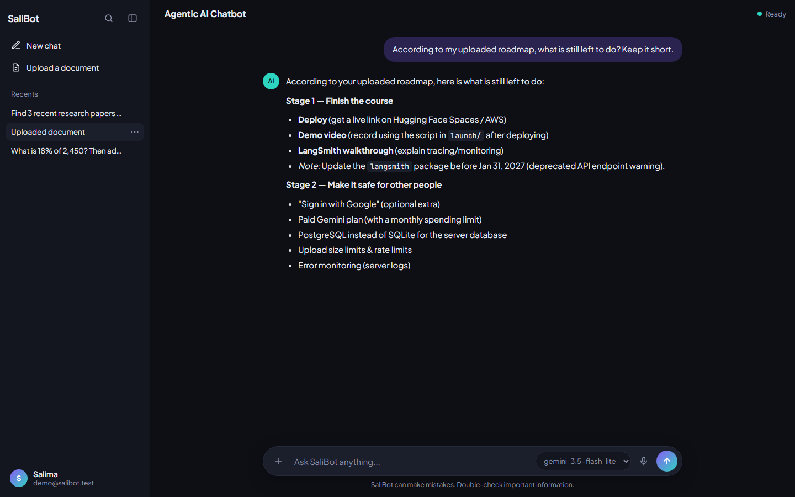
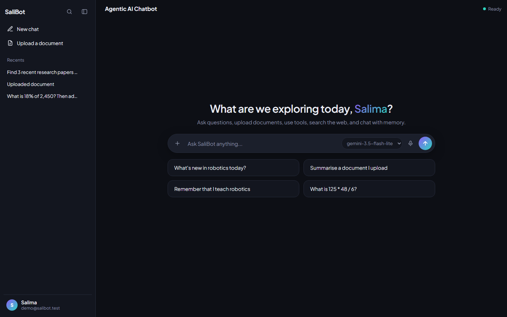
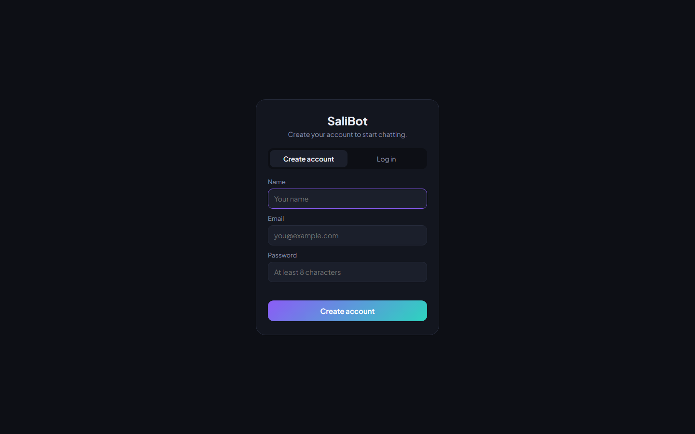
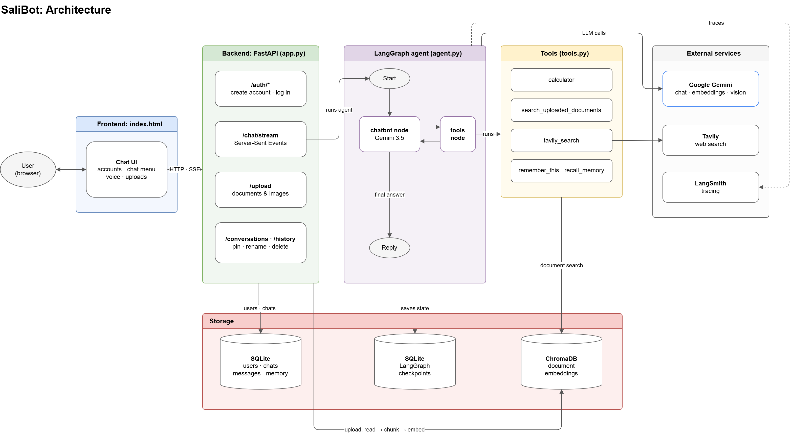
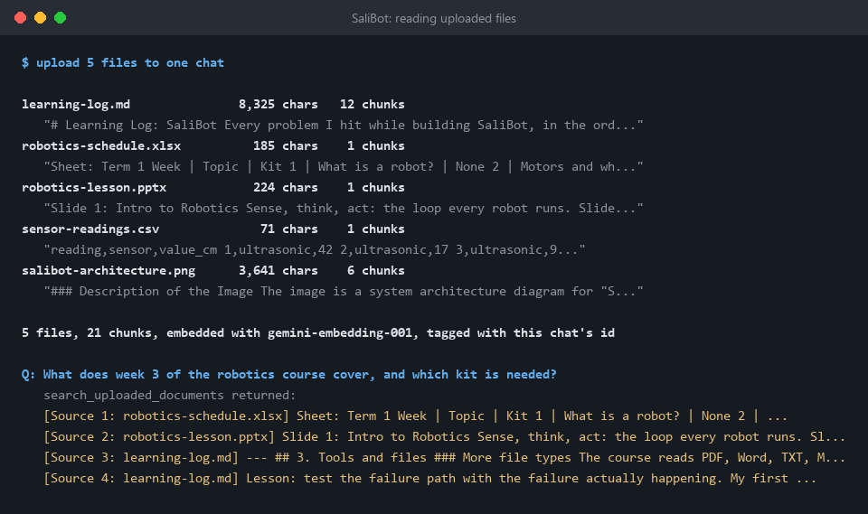

# SaliBot

[](https://github.com/Iddrisusalima/SaliBot/actions/workflows/ci.yml)
[](https://www.python.org/downloads/)
[](LICENSE)
[](https://ai.google.dev/)
[](https://langchain-ai.github.io/langgraph/)
[](Dockerfile)

An agentic AI chatbot that decides for itself when to search the web, read the
documents you upload, look up research papers, summarise a YouTube video,
remember something about you, or do the maths, and streams its answer word by
word. Each user has an account and only ever sees their own chats. SaliBot
started as the project in DSwithBappy's agentic chatbot course and was then
extended well beyond it: four extra tools, more file types, image reading, voice
input, accounts, a chat menu, and automatic fallback when a model is busy.

**Try it live: [salibot.onrender.com](https://salibot.onrender.com)**. It runs on a free server that sleeps when
nobody is using it, so the first visit can take about a minute to wake up.

---

## Table of contents

- [Demo](#demo)
  - [What happens inside the agent](#what-happens-inside-the-agent)
  - [Chatting with an uploaded document](#chatting-with-an-uploaded-document)
- [What SaliBot can do](#what-salibot-can-do)
- [Architecture](#architecture)
  - [Components](#components)
  - [One message, end to end](#one-message-end-to-end)
  - [Design decisions worth stating](#design-decisions-worth-stating)
- [Project layout](#project-layout)
- [Prerequisites](#prerequisites)
- [Installation](#installation)
- [Usage](#usage)
  - [Inspecting each stage](#inspecting-each-stage)
- [Key concepts](#key-concepts)
- [File types, and how each one is read](#file-types-and-how-each-one-is-read)
- [Settings, and why](#settings-and-why)
- [Deployment](#deployment)
- [Verification](#verification)
- [What I Learned](#what-i-learned)
- [Known limitations and out of scope](#known-limitations-and-out-of-scope)
- [Documentation](#documentation)
- [Acknowledgements](#acknowledgements)
- [License](#license)

---

## Demo



Asked for recent papers, the agent chose two tools on its own: the arXiv search
(newest first, because the question said "recent") and a web search to fill in
context. Every paper comes with a link that can be opened and checked.

### What happens inside the agent



This is the same agent run step by step from the terminal. On the second
question it called **two tools at once**, `recall_memory` and `calculator`,
then wrote one answer from both results. Nothing told it which tools to use;
it decided from the question and the tool descriptions. The memory it recalled
was saved by the first question through `remember_this`.

### Chatting with an uploaded document



The project's own roadmap was uploaded as a Markdown file, split into 6 chunks
and embedded. The agent searched those chunks and answered from them. They
belong to this chat alone: another chat, or another user, cannot search them.

### Start screen and accounts

| Start screen | Create an account |
| --- | --- |
|  |  |

---

## What SaliBot can do

| Feature | How it works |
| --- | --- |
| **Agentic reasoning** | A LangGraph agent decides by itself when to answer directly and when to use a tool |
| **Live web search** | Tavily search for today's news, prices and anything time-sensitive |
| **Chat with your documents (RAG)** | Upload PDF, Word, TXT, Markdown, Python, CSV, Excel, PowerPoint or images; SaliBot searches them by meaning |
| **Reads pictures** | Gemini vision describes images and copies any text in them, such as photos of whiteboard notes |
| **Long-term memory** | "Remember that I teach robotics" is saved and recalled later |
| **Forget on request** | "Forget what I told you about..." deletes the saved memory |
| **Research papers** | Searches arXiv on any topic, newest first when you ask for recent ones |
| **YouTube summaries** | Paste a YouTube link; Gemini watches the video and summarises it |
| **Knows today's date** | A date and time tool, so "this week" questions are answered correctly |
| **Calculator** | Arithmetic and maths functions, through a parser that refuses anything that is not maths |
| **Streaming replies** | Answers appear word by word, with a live label for the tool in use |
| **Voice input** | Record a message; Gemini transcribes it |
| **User accounts** | Create an account and log in; every user only sees their own chats |
| **Chat management** | Pin, rename and delete chats |
| **Model picker and fallback** | Choose a Gemini model per message; if it is busy, SaliBot switches to a backup |
| **Observability** | Every run is traced in LangSmith: latency, tokens, tool calls and errors |

---

## Architecture

A message goes through three layers. **FastAPI** checks who you are and that
the chat is yours. The **LangGraph agent** loops between Gemini and the tools
until Gemini has an answer. The answer is **streamed** back to the page while
the database, ChromaDB and LangSmith record what happened.



Editable source: [`docs/architecture.drawio`](docs/architecture.drawio), open
it with [draw.io](https://app.diagrams.net).

### Components

- **Web server** (`app.py`): FastAPI routes for the page, accounts, chats,
  uploads, voice transcription and the streaming chat endpoint. Filters the
  stream so only answer text reaches the page, and turns Google's errors into
  one-sentence messages.
- **Agent** (`agent.py`): a LangGraph `StateGraph` with two nodes, `chatbot`
  and `tools`, joined by `tools_condition`. The system prompt tells Gemini what
  SaliBot is and when each tool is the right one. A `SqliteSaver` checkpointer
  keeps each chat's state between messages.
- **Tools** (`tools.py`): nine tools: web search, calculator, document search,
  remember, recall, forget, date and time, arXiv papers and YouTube summaries.
  Tools that touch a chat receive its id through LangGraph's per-request
  `RunnableConfig`, never through a shared variable.
- **Documents** (`rag.py`): reads each file type, splits the text into
  900-character chunks with 150 characters of overlap, embeds them with
  `gemini-embedding-001`, and stores them in ChromaDB tagged with the chat id.
  Search is filtered by that tag.
- **Database** (`database.py`): SQLAlchemy models for users, login sessions,
  chats, messages and long-term memories. Uses PostgreSQL when `DATABASE_URL`
  is set (for example a free Neon database), otherwise a local SQLite file.
- **Page** (`templates/index.html`): HTML, CSS and plain JavaScript. Reads the
  stream, renders Markdown safely (marked + DOMPurify), records voice, and
  shows which tool is running.

### One message, end to end

The page sends the message with the login token. FastAPI looks the token up,
confirms the chat is new or belongs to this user, and saves the message. The
agent sends the conversation and system prompt to Gemini. If Gemini asks for a
tool, the tools node runs it with the chat id from the request config and hands
the result back; this can repeat. When Gemini answers in text, each token is
streamed to the page as a server-sent event, the full answer is saved, and
LangSmith holds the trace of every step. If the chosen model is busy before
any words are shown, the same message is retried on a backup model and the page
says so.

### Design decisions worth stating

- **Per-request state, not global state.** The course keeps the current chat id
  in one global variable. With two users at once, a tool could read the other
  person's chat. Passing it through `RunnableConfig` makes each run carry its own.
- **Filter the stream, do not trust it.** `stream_mode="messages"` emits tool
  calls and raw tool output too. Only AI text from the `chatbot` node reaches
  the page; everything else becomes a small "Searching..." label.
- **A busy model is not an error the user should handle.** Free-tier Gemini
  often returns `503`. SaliBot checks the checkpointer: if the run was saved it
  resumes it on a backup model, otherwise it sends the question again, so the
  conversation never holds the question twice.
- **Another user's chat returns 404, not 403.** It does not confirm the chat exists.
- **The calculator cannot run code.** The course passes the model's expression to
  `eval()`, so a prompt-injected "calculation" could read files or run commands
  on the server. SaliBot parses the expression into a tree and evaluates only
  numbers, operators and a list of maths functions, with limits on exponents.

---

## Project layout

```text
app.py                  FastAPI server: page, accounts, chats, uploads,
                        voice transcription, streaming, model fallback
agent.py                LangGraph agent, system prompt, model list
tools.py                The nine agent tools
rag.py                  Read files, chunk, embed, store and search in ChromaDB
database.py             Database models: users, sessions, chats, messages, memory
                        (PostgreSQL when DATABASE_URL is set, else SQLite)
templates/
  index.html            The chat page

scripts/
  test_agent.py         Talk to the agent in the terminal, no web page
  reset_password.py     Reset an account password (for whoever runs the server)

requirements.txt        Pinned dependencies
.env.example            Template for environment variables (tracked)
.env                    Your real API keys (git-ignored, never committed)
Dockerfile              The image used by Render and AWS
.dockerignore           Keeps .env, databases and uploads out of the image

README.md               This file
ROADMAP.md              What is done and what comes next
notes/
  learning-log.md       Every problem I hit and how I fixed it
docs/
  architecture.drawio   Editable source for the diagram above
  architecture.png
  screenshots/          The images in this README, each with the
                        transcript it was made from (.txt)
.github/
  workflows/ci.yml      CI: byte-compiles every module on 3.11 and 3.12
  workflows/cicd.yaml   The course's AWS ECR + EC2 deploy (manual trigger)
```

Created when the app runs, all git-ignored: `data/` (SQLite databases, only when
no `DATABASE_URL` is set),
`chroma_db/` (document embeddings) and `uploads/` (uploaded files).

---

## Prerequisites

| Requirement | Details |
| --- | --- |
| **Python** | 3.11 or newer. Developed on 3.11; CI tests 3.11 and 3.12. |
| **Gemini API key** | Free from [Google AI Studio](https://aistudio.google.com/apikey). No payment method needed. |
| **Tavily API key** | Free from [Tavily](https://app.tavily.com), for web search. |
| **LangSmith API key** | Optional, free from [LangSmith](https://smith.langchain.com), for tracing. |
| **OS** | Cross-platform. Developed on Windows 11; the Docker image runs on Linux. |

---

## Installation

### 1. Clone the repository

```bash
git clone https://github.com/Iddrisusalima/SaliBot.git
cd SaliBot
```

### 2. Create an environment

With conda:

```bash
conda create -n salibot python=3.11 -y
conda activate salibot
```

Or with venv on Windows (PowerShell):

```powershell
python -m venv venv
venv\Scripts\Activate.ps1
```

### 3. Install dependencies

```bash
pip install -r requirements.txt
```

### 4. Add your API keys

Copy the template, then open `.env` and paste your keys:

```bash
cp .env.example .env
```

On Windows PowerShell use `copy .env.example .env`.

### 5. Run it

```bash
python app.py
```

Open **http://localhost:8080**, create an account, and start chatting.

---

## Usage

Things to try once you are logged in:

| Ask | Tool the agent picks |
| --- | --- |
| "What's new in robotics today?" | Web search |
| Upload a PDF, then "Summarise this document" | Document search |
| "Remember that I teach robotics", later "What do I teach?" | Remember, then recall |
| "Forget what I told you about my job" | Recall, then forget |
| "Find 3 recent papers on agentic AI, newest first" | arXiv search |
| Paste a YouTube link and "Summarise this video" | YouTube summary |
| "What is 18% of 2,450?" | Calculator |
| "What's the date today?" | Date and time |

Use the dropdown in the message box to pick a model. Hover over a chat in the
sidebar and open its menu to pin, rename or delete it. Deleting a chat removes
its messages, memories, uploaded files and embeddings.

### Inspecting each stage

| To see | Where |
| --- | --- |
| Which tool the agent is using right now | The label above the answer while it streams, for example "Searching the web" |
| Every step of a run: prompt, tool calls, arguments, results, tokens, time | LangSmith, project `salibot` (set `LANGSMITH_TRACING=true` in `.env`) |
| The agent without the web page | `python scripts/test_agent.py` |
| What each screenshot in this README was made from | The `.txt` file with the same name in [`docs/screenshots/`](docs/screenshots) |

If someone forgets their password, whoever runs the server can reset it. The
new password is typed hidden and every session for that account is logged out:

```bash
python scripts/reset_password.py
```

---

## Key concepts

Short version here. The problems behind each one are in
**[`notes/learning-log.md`](notes/learning-log.md)**.

**An agent** is a model in a loop. Gemini reads the conversation and either
answers or asks for a tool; the tool runs, its result goes back to Gemini, and
the loop repeats until Gemini answers in text. In LangGraph that loop is two
nodes, `chatbot` and `tools`, and one condition between them.
→ [Read more](notes/learning-log.md#2-the-agent)

**Tool calling** means the model picks a tool and fills in its arguments from
the tool's name, description and parameters alone. So the docstring is the
interface: most of SaliBot's agent fixes were changes to words, not code.
→ [Read more](notes/learning-log.md#2-the-agent)

**RAG (retrieval-augmented generation)** lets the model answer from documents
it was never trained on. Uploaded files are split into overlapping chunks,
each chunk is turned into an embedding (a list of numbers placed by meaning),
and a question is matched to the nearest chunks, which are handed to the model.
→ [Read more](notes/learning-log.md#3-tools-and-files)

**State per request** is what makes a chatbot safe for more than one person.
The chat id travels with each run in `RunnableConfig`, so two people chatting
at the same moment never read or write each other's memories or documents.
→ [Read more](notes/learning-log.md#4-streaming-and-per-user-state)

**Checkpoints** are LangGraph's saved copy of each chat after every step.
They give the agent its short-term memory between messages, and they are what
lets SaliBot resume a run on a backup model when Gemini is busy.
→ [Read more](notes/learning-log.md#7-reliability-when-gemini-is-busy)

---

## File types, and how each one is read

Every file becomes plain text first, then goes through the same chunking and
embedding. What differs is how the text is pulled out.



| Type | Read with | What becomes text |
| --- | --- | --- |
| `.pdf` | pypdf | The text layer of every page (a scanned PDF has none) |
| `.docx` | docx2txt | The document's text |
| `.txt` `.md` `.py` `.csv` | Plain read | The file as it is |
| `.xlsx` | openpyxl | Every sheet, one line per row: `Week \| Topic \| Kit` |
| `.pptx` | python-pptx | The text on every slide, labelled `Slide 1:`, `Slide 2:` |
| `.png` `.jpg` `.jpeg` `.webp` | Gemini vision | A description of the image plus any text written in it |

The image row is the one worth a second look. In this test I uploaded
SaliBot's own architecture diagram as a picture. It has no text layer at all, yet it became 3,641 characters and 6 searchable
chunks, because Gemini described it. In the same test a 185-character
spreadsheet became 1 chunk, and asked which kit week 3 needs, document search
returned that spreadsheet first out of 21 chunks.

---

## Settings, and why

| Setting | Value | Reasoning |
| --- | --- | --- |
| Default model (`GOOGLE_MODEL`) | `gemini-3.5-flash-lite` | The course's `gemini-2.5-flash` is closed to new keys. The free daily limit on `gemini-3.5-flash` ran out fastest, so `flash-lite` became the default. |
| Fallback order | `flash-lite`, then `flash` | Tried when the chosen model is busy before answering. Most reliable first. |
| Temperature | 0.3 | Low, so tool choices and facts stay steady, with some variety left in the wording. |
| Chunk size / overlap | 900 / 150 characters | The course's values, kept. The overlap (about 17%) means a sentence cut at a boundary still appears whole in the next chunk. |
| Chunks returned per search | 4 | The course's value. In the test above the right chunk came back first. |
| Embedding model | `gemini-embedding-001` | Uses the same Google key, with nothing to download. A question must be embedded by the same model as the documents. |
| Password hashing | PBKDF2-SHA256, 200,000 rounds, random salt | Slow on purpose, so a stolen database cannot be guessed through quickly. |
| Minimum password length | 8 characters | Checked when the account is created. |
| Voice recording limit | 20 MB | Larger recordings are refused before they are sent to Gemini. |
| Default timezone | `Africa/Accra` | Used by the date tool unless another timezone is asked for. |

---

## Deployment

### Render (free)

SaliBot is live at **[salibot.onrender.com](https://salibot.onrender.com)**, a free Render web service built from the same
`Dockerfile`. Render rebuilds and redeploys it on every push to `main`.

1. Sign up at [render.com](https://render.com) with GitHub.
2. New, Web Service, pick this repository. Runtime **Docker**, instance type **Free**.
3. Add the environment variables from [`.env.example`](.env.example), plus `PORT=8080`.
   They are stored by Render, never in the image: `.dockerignore` excludes `.env`.
4. Deploy. The first build takes about 5 to 10 minutes.

Measured locally, SaliBot uses about 200 MB of memory while answering a
document question, inside the free plan's 512 MB. Two things to know about the
free plan: the service sleeps after 15 minutes without visitors and takes about
a minute to wake, and its disk is not kept between restarts.

So accounts, chats, memories and the agent's conversation state live in a free
**Neon** PostgreSQL database instead: set `DATABASE_URL` to Neon's connection
string in Render's environment variables. Without it, SaliBot falls back to local
SQLite files, which is what you want on your own machine. Tested by creating an
account and a chat, deleting the local files, starting a fresh process, and
logging back in: the account, the pinned chat, its history and the agent's
memory of it were all still there.

Uploaded documents are the one thing not kept yet: their embeddings are in a
local ChromaDB folder, so they need uploading again after a restart.

Hugging Face Spaces was the first plan, but Docker Spaces now need a paid
account, so the Dockerfile's non-root user setup is kept because it is good
practice on any host.

### AWS with GitHub Actions (ECR + EC2)

The course's pipeline is in `.github/workflows/cicd.yaml`: build the image, push
it to Amazon ECR, and run it on an EC2 self-hosted runner. It is set to run
manually from the Actions tab, so it does not fail on every push without AWS set
up. To use it:

1. Create an IAM user with `AmazonEC2ContainerRegistryFullAccess` and `AmazonEC2FullAccess`.
2. Create an ECR repository, for example `salibot`.
3. Launch an Ubuntu EC2 instance and allow inbound TCP 8080.
4. Install Docker on the instance:
   ```bash
   curl -fsSL https://get.docker.com -o get-docker.sh
   sudo sh get-docker.sh
   sudo usermod -aG docker ubuntu
   newgrp docker
   ```
5. Register the instance as a self-hosted runner: repository Settings, Actions,
   Runners, New self-hosted runner, Linux, then run the commands it shows.
6. Add the repository secrets: `AWS_ACCESS_KEY_ID`, `AWS_SECRET_ACCESS_KEY`,
   `AWS_DEFAULT_REGION`, `ECR_REPO`, `GOOGLE_API_KEY`, `GOOGLE_MODEL`,
   `TAVILY_API_KEY`, `LANGSMITH_TRACING`, `LANGSMITH_ENDPOINT`,
   `LANGSMITH_API_KEY`, `LANGSMITH_PROJECT`.
7. Run the workflow from the Actions tab.

---

## Verification

Every failure below was triggered on purpose and the response observed, not
just coded for and assumed.

### Automated

CI runs on every push across Python 3.11 and 3.12. It byte-compiles every
module and script, checks the files the app needs are present, and checks no
`.env` file was committed. It installs nothing and calls no API, so it needs no
secrets.

```bash
python -m compileall -q *.py scripts
```

### Manual failure injection

| Failure | How it was forced | Behaviour |
| --- | --- | --- |
| Not logged in | Listed chats without a token | 401, "Please log in first." |
| Another user's chat | User B opened, renamed and deleted user A's chat | 404 "Chat not found." for all three |
| Logged out token reused | Called `/auth/me` after logging out | 401, the token no longer works |
| Wrong password | Logged in with the wrong password | 401, "Wrong email or password." |
| Weak signup | Short password, invalid email, existing email | 400 with a message for each |
| Unsupported file | Uploaded an `.exe` | 400, names the file types it accepts |
| Empty message | Sent only spaces | 400, "Message is required." |
| Model closed to new keys | Called `gemini-2.5-flash` on a new key | One-line message to pick another model |
| Free daily limit used up | Hit the `429` quota | One-line message to switch model or wait |
| Model busy before answering | Made the chosen model fail with `503`, before and after its step was saved | Switched to `gemini-3.5-flash-lite`, answered, question stored once |
| Code passed to the calculator | `open('.env').read()`, `__import__('os')`, `().__class__...` | Refused: "only numbers, operators and maths functions" |
| Calculation that would freeze the server | `9**9**9`, `factorial(100000)` | Refused instantly: "too large" |
| Model busy mid-answer | Made the model fail with `503` after its first words | Partial answer kept, shown and saved, marked as possibly incomplete |

---

## What I Learned

The full list, with causes and fixes, is in
[`notes/learning-log.md`](notes/learning-log.md). The four that changed how I
think:

**A tutorial is a snapshot.** The course's `gemini-2.5-flash` returned 404 on my
key: it had closed to new accounts. Nothing was wrong with my code. I listed the
models my key could see, tested them, and moved SaliBot to Gemini 3.5. When a
step fails, check whether the world changed before assuming I made a mistake.

**An agent is only as good as its tool descriptions.** The model picks a tool
from its docstring. Asking for "recent" papers returned relevant but old ones
until the arXiv tool had a `newest_first` option and a docstring saying when to
use it. Most of my agent fixes were changes to words, not code.

**"It works when I test it" is a single-user test.** The course's global chat id
is fine for one person in a terminal. Two people sending at once could have their
memories saved into each other's chats. State that belongs to a request has to
travel with the request.

**Test the failure with the failure actually happening.** My first model
fallback looked right and crashed when tested, because it tried to resume a run
that had never been saved. The fix was to ask the checkpointer which case I am
in before retrying.

---

## Known limitations and out of scope

- **Uploaded documents are not kept across restarts** on the free host. Their
  embeddings live in a local ChromaDB folder; moving them to a hosted vector store
  (or pgvector in the same PostgreSQL database) is the next step.
- **No upload size or rate limits** yet, beyond Gemini's own quota.
- **Free-tier Gemini** has a small daily quota and is often busy. The fallback
  helps; a paid plan with a spending limit is the real fix.
- **Login is email and password only.** "Sign in with Google" is on the roadmap.

What comes next is in [`ROADMAP.md`](ROADMAP.md).

---

## Documentation

| Document | Contents |
| --- | --- |
| [`notes/learning-log.md`](notes/learning-log.md) | Every problem hit while building SaliBot, why it happened, and what changed. |
| [`ROADMAP.md`](ROADMAP.md) | What is finished and what comes next. |
| [`docs/architecture.drawio`](docs/architecture.drawio) | The architecture diagram, editable in [draw.io](https://app.diagrams.net). |
| [`docs/screenshots/`](docs/screenshots) | The screenshots in this README, each with the transcript it was made from. |
| [`.env.example`](.env.example) | Every setting SaliBot reads, with where to get each key. |

---

## Acknowledgements

Built while following **DSwithBappy's** course *"Build Your Own ChatGPT Agent
with LLMs, LangGraph, FastAPI, LangSmith, ChromaDB, SQLAlchemy & AWS"*, then
extended with accounts, a chat menu, four extra tools, extra file types, image
reading, voice transcription, model fallback and a redesigned interface.

## Author

**Salima Iddrisu**, AI engineer and robotics instructor.
GitHub: [@Iddrisusalima](https://github.com/Iddrisusalima)

## License

Released under the [Apache License 2.0](LICENSE).
