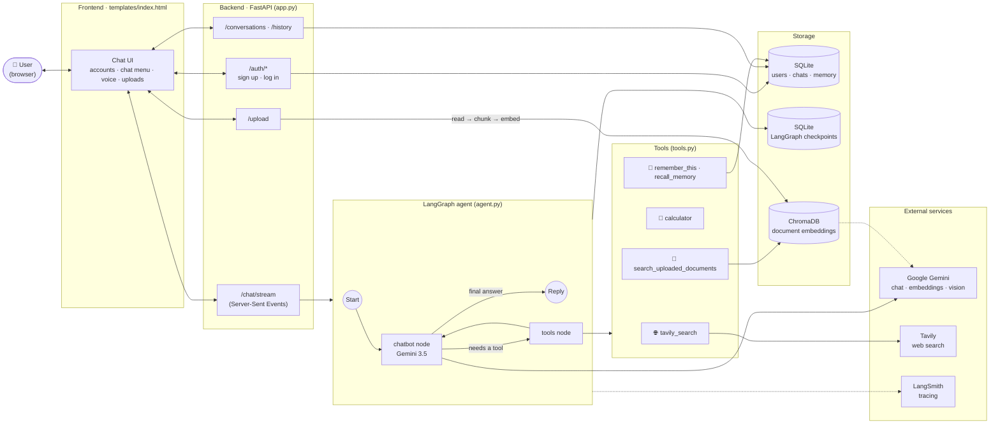

<div align="center">

# SaliBot 🤖

**An agentic AI chatbot that searches the web, reads your documents, remembers you, and does the maths, built with LangGraph, FastAPI and Google Gemini.**


</div>

---

## ✨ What SaliBot can do

| | Feature | How it works |
|---|---|---|
| 🧠 | **Agentic reasoning** | A LangGraph agent decides by itself when to answer directly and when to use a tool |
| 🌐 | **Live web search** | Tavily search for today's news, prices and anything time-sensitive |
| 📄 | **Chat with your documents (RAG)** | Upload **PDF, Word, TXT, Markdown, CSV, Excel, PowerPoint or images**; SaliBot searches them by meaning and cites the file |
| 🖼️ | **Reads pictures** | Gemini vision describes images and copies any text in them (e.g. photos of whiteboard notes) |
| 💾 | **Long-term memory** | "Remember that I teach robotics" → saved and recalled later |
| 🧮 | **Calculator** | A safe, sandboxed maths tool |
| ⚡ | **Streaming replies** | Answers appear word by word, with live tool status ("Searching the web…") |
| 🎙️ | **Voice input** | Record a message; Gemini transcribes it |
| 🔐 | **User accounts** | Create an account / log in; every user only sees their own chats |
| 📌 | **Chat management** | Pin, rename and delete chats from a ⋯ menu |
| 🔀 | **Model picker** | Switch between Gemini models per message |
| 📊 | **Observability** | Every run is traced in LangSmith (latency, tokens, tool calls, errors) |

---

## 🏗️ Architecture



**How a message flows**

1. You send a message; FastAPI checks your login and that the chat is yours.
2. The **LangGraph agent** sends the conversation (plus SaliBot's system prompt) to **Gemini**.
3. If Gemini asks for a tool, the **tools node** runs it (web search, calculator, document search or memory) and loops back to Gemini.
4. When Gemini is ready, the answer is **streamed** back to the browser word by word.
5. Messages are saved to SQLite; LangGraph checkpoints keep the conversation's state; LangSmith records the whole run.

---

## 🧰 Tech stack

| Layer | Technology |
|---|---|
| LLM | Google Gemini 3.5 (`gemini-3.5-flash-lite` default) via `langchain-google-genai` |
| Agent | LangGraph (`StateGraph`, `ToolNode`, `tools_condition`, `SqliteSaver`) |
| Backend | FastAPI + Uvicorn, Server-Sent Events streaming |
| RAG | ChromaDB + `gemini-embedding-001`, `RecursiveCharacterTextSplitter` |
| File readers | pypdf, docx2txt, openpyxl, python-pptx, Gemini vision |
| Database | SQLite + SQLAlchemy |
| Web search | Tavily |
| Observability | LangSmith |
| Frontend | HTML, CSS, vanilla JavaScript (marked + DOMPurify for Markdown) |
| DevOps | Docker, GitHub Actions, AWS ECR + EC2 |

---

## 📁 Project structure

```
SaliBot/
├── app.py              # FastAPI server: pages, accounts, chat streaming, uploads
├── agent.py            # LangGraph agent, system prompt, model selection
├── tools.py            # Agent tools: web search, calculator, documents, memory
├── rag.py              # Document reading, chunking, embeddings, ChromaDB search
├── database.py         # SQLite models: users, sessions, chats, messages, memory
├── templates/
│   └── index.html      # The chat interface
├── test_agent.py       # Terminal test for the agent
├── requirements.txt
├── Dockerfile
├── .dockerignore
└── .github/workflows/
    └── cicd.yaml       # CI/CD: build → push to ECR → deploy on EC2
```

---

## 🚀 Run it locally

**1. Clone the repository**
```bash
git clone https://github.com/Iddrisusalima/SaliBot.git
cd SaliBot
```

**2. Create and activate a virtual environment**
```bash
conda create -n salibot python=3.11 -y
conda activate salibot
```

**3. Install the dependencies**
```bash
pip install -r requirements.txt
```

**4. Add your API keys:** create a `.env` file in the project folder:
```env
GOOGLE_API_KEY=your_gemini_key
GOOGLE_MODEL=gemini-3.5-flash-lite
TAVILY_API_KEY=your_tavily_key
LANGSMITH_TRACING=true
LANGSMITH_ENDPOINT=https://api.smith.langchain.com
LANGSMITH_API_KEY=your_langsmith_key
LANGSMITH_PROJECT=salibot
```
Free keys: [Google AI Studio](https://aistudio.google.com/apikey) · [Tavily](https://app.tavily.com) · [LangSmith](https://smith.langchain.com)

**5. Run the app**
```bash
python app.py
```
Open **http://localhost:8080**, create an account, and start chatting.

---

## ☁️ Deployment

### Option A: AWS with CI/CD (GitHub Actions + ECR + EC2)

Every push to `main` builds a Docker image, pushes it to Amazon ECR and redeploys it on EC2.

1. **Create an IAM user** with `AmazonEC2ContainerRegistryFullAccess` and `AmazonEC2FullAccess`.
2. **Create an ECR repository** (e.g. `salibot`).
3. **Launch an Ubuntu EC2 instance** and allow inbound **TCP 8080**.
4. **Install Docker on EC2:**
   ```bash
   sudo apt-get update -y && sudo apt-get upgrade -y
   curl -fsSL https://get.docker.com -o get-docker.sh
   sudo sh get-docker.sh
   sudo usermod -aG docker ubuntu
   newgrp docker
   ```
5. **Register EC2 as a self-hosted runner:** GitHub repo → Settings → Actions → Runners → New self-hosted runner → Linux, then run the commands shown.
6. **Add GitHub secrets** (Settings → Secrets and variables → Actions):
   `AWS_ACCESS_KEY_ID`, `AWS_SECRET_ACCESS_KEY`, `AWS_DEFAULT_REGION`, `ECR_REPO`,
   `GOOGLE_API_KEY`, `GOOGLE_MODEL`, `TAVILY_API_KEY`,
   `LANGSMITH_TRACING`, `LANGSMITH_ENDPOINT`, `LANGSMITH_API_KEY`, `LANGSMITH_PROJECT`
7. **Push to `main`.** The workflow in `.github/workflows/cicd.yaml` does the rest.

### Option B: Hugging Face Spaces (free, no card)

The same `Dockerfile` runs on a Docker Space. Add the API keys as **Space secrets**.

---

## 🔒 Security notes

- API keys live in `.env` (git-ignored) or in GitHub / Space **secrets**, never in the code.
- `.dockerignore` keeps `.env`, local databases and uploads out of the Docker image.
- Passwords are stored as salted PBKDF2-SHA256 hashes.
- Every chat, history, upload and delete request checks that the chat belongs to the logged-in user.

---

## 🗺️ Roadmap

- [ ] More tools: research-paper search (arXiv), YouTube summaries, current date/time, forget memory
- [ ] PostgreSQL for multi-user production hosting
- [ ] Next.js frontend

---

## 🙏 Acknowledgements

Built while following **DSwithBappy's** course *"Build Your Own ChatGPT Agent with LLMs, LangGraph, FastAPI, LangSmith, ChromaDB, SQLAlchemy & AWS"*, then extended with accounts, a chat menu, extra file types, image reading, voice transcription and a redesigned interface.

## 👩🏾‍💻 Author

**Salima Iddrisu**: AI engineer and robotics instructor
GitHub: [@Iddrisusalima](https://github.com/Iddrisusalima)

## 📄 License

Licensed under the [Apache License 2.0](LICENSE).
